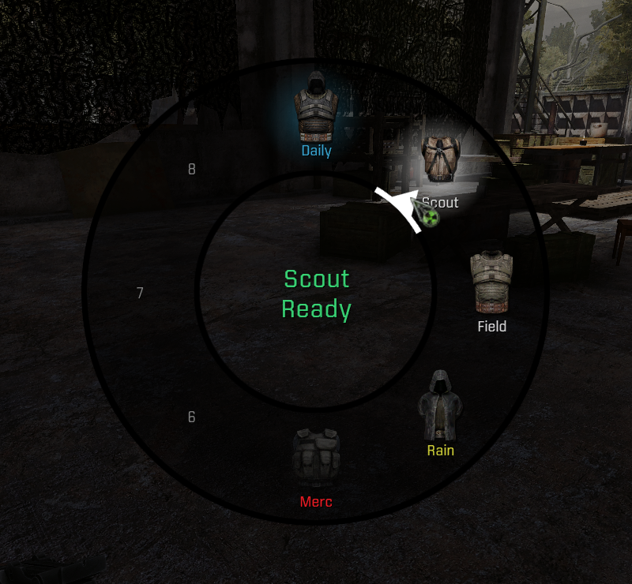
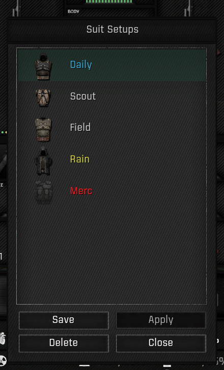
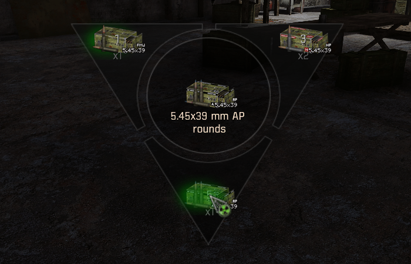

# Advanced Player Behavior

Player-control systems for the S.T.A.L.K.E.R. Anomaly modpack G.A.M.M.A. They
work on the keys you already use: the only new key is the optional Suit Setups
wheel key, and the mod adds no animations of its own. Every system except Suit
Setups and the Reload-tap ammunition wheel can be turned off in MCM.

- **Stances:** Crouch and Jump taps and holds move you between standing,
  crouching and prone.
- **Weapon readiness:** a supported weapon lowers itself in peace and raises
  itself for Aim, Fire and combat.
- **Visor wiping:** the game's own wipe starts once a supported mask's visor is
  wet enough.
- **Headlamp key:** taps and holds switch the headlamp, night vision, weapon
  function modes, 3DSS reticles and laser colours, depending on whether and
  how you are aiming.
- **Free Zoom:** iron-sight ADS remembers your last Free Zoom choice.
- **Suit Setups:** an eight-slot manager and wheel that swap to the exact
  items you saved, with FDDA Redone's equipment animations. They replace
  G_FLAT's Remember Belt Items.
- **Reloading with GAMMA Mags Reloaded:** a Reload tap opens an ammunition
  wheel, and a Reload hold field-loads your loadout magazines with Animated
  Magazine Loading (optional, not part of GAMMA).

It requires GAMMA Mags Reloaded 1.05, which is not part of GAMMA, and GAMMA's
G.A.M.M.A. Unjam Reload on the same key must be disabled.

## Screenshots

*The Suit Setups wheel, with the aimed setup's name and status in the centre.*

*The Suit Setups manager: each slot shows the saved suit and its name, coloured by status.*

*A Reload tap opens the ammunition wheel. The ammunition already loaded stays marked.*

## Download

Download the `.7z` from
[Releases](https://github.com/Q4ln/GAMMA-Advanced-Player-Behavior/releases/latest)
and install it with Mod Organizer 2's **Install Mod** button. Its MO2 priority
matters: see Installation in the README.

## Documentation

Requirements, installation, compatibility, options, saves, uninstalling, known
issues, the changelog and credits are in
[Advanced Player Behavior - README.md](https://github.com/Q4ln/GAMMA-Advanced-Player-Behavior/blob/main/Advanced%20Player%20Behavior%20-%20README.md),
which also ships inside the archive.

Apart from this page and its screenshots, the repository holds exactly the
files in the release archive.

## Licence

APB's own code is by Q4ln under CC BY-NC-SA 4.0; see
[Advanced Player Behavior - LICENSE.txt](https://github.com/Q4ln/GAMMA-Advanced-Player-Behavior/blob/main/Advanced%20Player%20Behavior%20-%20LICENSE.txt).
The third-party mods it integrates with remain under their authors' terms.
